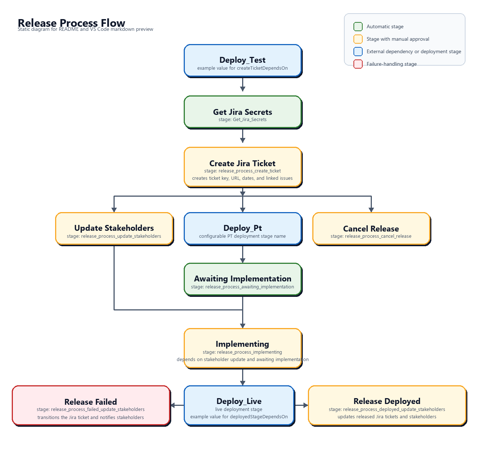

# Release Process Templates

Reusable Azure DevOps stage templates and a .NET 10 file-based command program for JIRA release management and Teams notifications. The workflow creates and tracks ITSM change tickets through deployment:

- Create an ITSM ticket when a release is marked for live deployment
- Notify stakeholders that the release is planned
- Mark the release as deployed once deployment completes
- Transition linked development tickets to Done after a successful live deployment

## Step-by-step: running a release

This section is for the people who run a release. The rest of this document is the setup and configuration reference for pipeline owners.

**Roles**

| Role | Who | Where they act |
|------|-----|----------------|
| Release driver | Developer running the release | Azure DevOps pipeline run |
| Reviewer | Peer who checks the change ticket | Jira ITSM ticket |
| Go Live approver | Person configured as `approver` | Jira ITSM ticket |

**Jira ticket lifecycle (Normal/Major change)**

`Review` → `Planning` → `Go Live Decision` → `Awaiting implementation` → `Implementing` → `Completed` (or `Failed` / cancelled)

### Steps

1. **Start the run.** A run starts from `main`/`master`, or from a release branch when the pipeline sets `releaseBranchCondition`, after a merge or a manual queue. Pull-request builds never create a release ticket. Optional queue-time parameters set the change type, planned window (default: start in 24 hours, 1 hour long), reason, risk and impact.
2. **Deploy to test.** Earlier stages (for example `Deploy_Test`) run as usual. The release process starts only after them.
3. **Approve the ticket creation** — *release driver, Azure DevOps.* Stage `release_process_create_ticket` pauses on **Approve JIRA Release Ticket Creation**. **Whoever approves becomes the Jira reporter.** That person's Azure DevOps email must match an active Jira account that is assignable in the release project. If no match is found, ticket creation fails; it never falls back to the service account. If `skipManualApproval: true`, this step is skipped and the configured `reporter` (or the service account) is used.
4. **The ticket is created** — *automatic.* The pipeline:
   - Generates release notes from the commits between the latest `live` Git tag and the commit being deployed. The tag must be an ancestor of that commit, otherwise the step fails.
   - Creates the ITSM ticket and links the development tickets it found.
   - Moves a Normal/Major ticket to `Review`. Standard/Emergency tickets go directly to `Awaiting implementation`.

   The ticket key and link appear in the stage output.
5. **Notify stakeholders (planned)** — *release driver, Azure DevOps.* Approve **Approve Stakeholder Notification** to send the "planned release" Teams message. This runs in parallel with the next steps.
6. **Deploy to PT.** The PT stage (default `Deploy_Pt`) runs. The Jira gates below wait for it.
7. **Review the change** — *reviewer, Jira.* Check the ticket (description, release notes, planned window, Service Impact). Then move it from `Review` to `Planning`.
8. **Acknowledge the review** — *release driver, Azure DevOps.* Stage `release_process_awaiting_implementation` pauses on **Acknowledge Jira Review**. Approve it only after the ticket is in `Planning`. The pipeline then moves the ticket to `Go Live Decision`. This acknowledgment is **not** the Go Live approval.
9. **Approve Go Live** — *Go Live approver, Jira.* Complete the Go Live Decision in Jira. Jira moves the ticket to `Awaiting implementation`.
10. **Confirm Go Live in the pipeline** — *release driver, Azure DevOps.* If the ticket was not yet in `Awaiting implementation`, the pipeline pauses on **Wait For Jira Go Live Approval**. Resume it after the Jira approval. The pipeline checks the status again and fails if the approval is still missing.
11. **Start the implementation** — *release driver, Azure DevOps.* Stage `release_process_implementing` pauses on **Approve Transition to IMPLEMENTING**. On approval, it checks once more that the ticket is in `Awaiting implementation`, moves it to `Implementing`, and sets the Change start date.
12. **Deploy to live.** The live deployment stage (for example `Deploy_Live`) runs, followed by the post-live Git tagging stage. That tag is the baseline for the next release's notes.
13. **Close the release** — *release driver, Azure DevOps.* Stage `release_process_deployed_update_stakeholders` pauses on **Approve Update of Deployed Release**. On approval, the pipeline:
    - Moves the linked development tickets to `Done`.
    - Sets the completion date and Post-Implementation Status.
    - Moves the ITSM ticket to `Completed`.
    - Sends the "deployed" Teams message.

### If something goes wrong

- **Live deployment fails.** `release_process_failed_update_stakeholders` runs automatically, moves the ticket to `Failed`, and sends the failure notification.
- **The release must be cancelled.** Approve **Approve Cancel Release** in `release_process_cancel_release` to cancel the Jira ticket and notify stakeholders. This does **not** stop deployment stages. Cancel the pipeline run as well.
- **Ticket creation fails with "Could not match the manual approver…".** The approver's Azure DevOps email does not match exactly one active Jira account that is assignable in the release project. Re-run the stage and have a person with a matching, assignable Jira account approve it.
- **Ticket creation fails on Git tags.** No `live` tag exists, or the latest one is not an ancestor of the deployed commit. Seed or fix the baseline tag (see [Setup Notes](#setup-notes)).
- **Implementing fails with "manual Jira approval is missing".** The Go Live Decision was not completed in Jira. Approve it, then re-run the failed stage.

## Flow Overview

The wrapper template `release-process-stages.yaml` expands into this stage flow:



Stage behavior in practice:

- `release_process_create_ticket` runs after any stages listed in `createTicketDependsOn`, for example `Deploy_Test`. Its first job fetches and exports the Jira credentials and webhook URL, then it creates the ITSM ticket (default change type **Normal**). **Normal/Major** tickets stop in `Review`; Standard/Emergency move directly to `Awaiting implementation`. The stage exposes the ticket key, URL, dates, and linked issues.
- `release_process_cancel_release` and `release_process_update_stakeholders` both explicitly depend on successful ticket creation. Cancel Release uses a `ManualValidation` approval before transitioning the Jira ticket. Approving it does **not** stop sibling deploy stages; cancel the pipeline run as well if deployment must stop.
- Your PT deployment stage, by default `Deploy_Pt`, sits between ticket creation and `release_process_awaiting_implementation`. Override `awaitingImplementationDependsOn` if your project uses a different stage name.
- `release_process_awaiting_implementation` first pauses for an acknowledgment that the reviewer completed the Jira review and moved the ticket from `Review` to `Planning`. It then transitions the ticket to `Go Live Decision` and waits until the approver completes the Jira Go Live Decision and the ticket reaches `Awaiting implementation`. The Go Live approval remains in Jira; the pipeline acknowledgment does not approve it.
- `release_process_implementing` requires pipeline approval and only runs after both `release_process_awaiting_implementation` and `release_process_update_stakeholders`. Before transitioning, it verifies that Jira is already in `Awaiting implementation`; otherwise it fails clearly because manual Jira approval is missing. It sets Change start date (`customfield_13306`) when transitioning to Implementing.
- Your live deployment stage, such as `Deploy_Live`, should run after `release_process_implementing`.
- `release_process_deployed_update_stakeholders` runs after the final post-live stage, which should normally be the Git tagging stage that follows the live deployment. Inside the stage, it sequences approval, Jira ticket updates (Change completion date, Post-Implementation Status, Completed), and the deployed stakeholder notification in that order.
- `release_process_failed_update_stakeholders` runs when the configured live deployment stage fails, sets completion fields, transitions the ITSM ticket to failed, and sends the failure notification.

That produces an [ITSM ticket](https://your-domain.atlassian.net/browse/ITSM-44807) like:


Notifications look like:


## Templates

### release-process-stages.yaml

A wrapper template that composes the stage templates below and preserves the current single-entry-point contract.

### Invocable stage templates

Each of these templates can be called directly under `stages:`:

| Template | Description |
|----------|-------------|
| `release-process-create-ticket.yaml` | Emits `release_process_create_ticket`, including Jira secret retrieval and ticket creation jobs |
| `release-process-awaiting-implementation.yaml` | Emits `release_process_awaiting_implementation`, collects the Jira review acknowledgment, advances Planning to Go Live Decision, and waits for Jira Go Live approval |
| `release-process-implementing.yaml` | Emits `release_process_implementing` and transitions the ITSM ticket to Implementing after manual approval (sets Change start date) |
| `release-process-update-stakeholders.yaml` | Emits `release_process_update_stakeholders` |
| `release-process-cancel-release.yaml` | Emits `release_process_cancel_release` |
| `release-process-release-deployed.yaml` | Emits `release_process_deployed_update_stakeholders`, updates linked Jira tickets, sets completion fields, closes the release ticket, then notifies stakeholders |
| `release-process-release-failed.yaml` | Emits `release_process_failed_update_stakeholders` |

`release-process-awaiting-implementation.yaml` expects your PT deployment stage, by default `Deploy_Pt`, to already exist in the pipeline, and it always adds `release_process_create_ticket` as a required dependency because it reads the Jira ticket outputs from that stage. `release-process-implementing.yaml` always depends on `release_process_create_ticket`, `release_process_awaiting_implementation`, and `release_process_update_stakeholders`, and you can append more dependencies if needed. `release-process-release-deployed.yaml` expects `release_process_create_ticket` and your final post-live stage, by default `Deploy_Live`, and that stage should normally run after `release_process_implementing`. Inside that stage, stakeholder notification waits for the Jira update job; linked implementation tickets are transitioned to `Done`, and the release ticket is transitioned to `Completed` even when no linked implementation tickets are found. If linked Done transitions or the Completed transition fail, the update job fails so the DEPLOYED notification does not run on a greenwashed result. If your pipeline creates a Git tag after the live deployment, point `deployedStageDependsOn` at that tagging stage. `release-process-release-failed.yaml` expects `release_process_create_ticket` and your live deployment stage, by default `Deploy_Live`, and it runs only when that stage fails. Both `release-process-update-stakeholders.yaml` and `release-process-cancel-release.yaml` explicitly depend on `release_process_create_ticket`.

## Setup Notes

- Jira API calls are executed via Atlassian Cloud API and require `JiraCloudId`.
- `release-process-jira-cloud-id` is mandatory; template fails early if missing.
- Jira issue transitions are resolved dynamically from Jira's `GET /rest/api/3/issue/{issueIdOrKey}/transitions` response for the current issue state.
- The transition POST still uses Jira's transition ID, but the template resolves that ID at runtime using target status selectors instead of relying on one fixed transition ID across the workflow.
- `release_process_awaiting_implementation` requires an Azure DevOps manual acknowledgment after the reviewer moves the Jira ticket from `Review` to `Planning`, then transitions it to `Go Live Decision`. The stage waits for the separate Jira Go Live approval to move the ticket to `Awaiting implementation` (`11505`) before continuing; the Implementing stage repeats the status check with `-FailIfBlocked`.
- Fixed field IDs used by automation include:
  - Change type: `customfield_13303`
  - Approver: `customfield_13301`
  - Service Impact: `customfield_18878`
  - Change start date: `customfield_13306`
  - Change completion date: `customfield_13307`
  - Post-Implementation Status: `customfield_16629`
- `failedTransitionId` is now an optional override. By default the failed-release stage resolves the transition dynamically to target status `Failed` (`14505`).
- `release_process_create_ticket` re-exports the Jira credentials and webhook as shared output variables for downstream stages.
- Jira custom field IDs for release ticket creation are still fixed in the `create-release-ticket` command, while field values such as change type, planned dates, change reason, change risk, change impact, service impact, `affectedServices`, `affectedComponents`, `teamCMDB`, `assignee`, `approver`, and `reporter` are configurable inputs.
- With ticket-creation manual approval enabled, the reporter is the person who approves **Approve JIRA Release Ticket Creation**, not the build requester, assigned Jira approver, or someone who approves a later gate. The template reads that exact task's approval from the current stage/job attempt using the build timeline and Azure DevOps approvals API, then matches `actualApprover.uniqueName` to exactly one active Jira user account using Jira's assignable-user search for the release project (`user/assignable/search?project=<projectKey>`). An exact visible email match is preferred; because Jira Cloud hides `emailAddress` for most profiles, a single active user with a hidden email returned by that search is also accepted, while visible mismatches, app accounts and multiple candidates are rejected. The build service needs permission to read the timeline/approval using `System.AccessToken`; the Jira service account needs **Assign issues** and **Modify reporter** in the release project (global *Browse users and groups* is not required). The approver must be assignable in that project. Missing or ambiguous identities and API failures block creation rather than substituting another reporter.
- `reporter` accepts an optional Jira account ID as a fallback **only when `skipManualApproval: true`**. If that fallback is empty, Jira uses the authenticated service account. Direct CLI calls retain the configured behavior by default; use `-ReporterSource ManualApproval` for approval-derived reporting. This resolution does not change the separate Jira Go Live approver.
- Default planned window is now +24 hours (rounded to the hour) with end = start + 1 hour, matching BU Pay & Credit / PayGate guidance.
- Do **not** use `Standard` unless you have a documented, pre-approved standard release procedure for that exact change. Typical live releases use `Normal`.
- Known follow-ups (not in this change): migrate Jira auth from bot email/token to OAuth 2.0 2LO for `jira-connection`; optional Account field (`customfield_15714`); stronger segregation-of-duties enforcement beyond ADO ManualValidation + Jira Review/Approve.
- Pipeline jobs run `scripts/ReleaseProcess.cs` with `dotnet run --file`, using the .NET 10 SDK installed by `UseDotNet@2`. The launcher downloads and caches the versioned self-contained Linux package from the `release-management-tools` GitHub repository; set the `RELEASE_TOOLS_VERSION` pipeline variable to override its default.
- Release note ticket links are generated with browse base `https://your-domain.atlassian.net`.
- The consuming release pipeline must include a Git tagging process after a successful live deployment. Release note generation selects the latest Git tag whose alphanumeric segments include the environment name (for example `live-2026.03.23.1` matches `live`; substring false positives like `opt` matching `pt` are avoided). The latest tag must be an ancestor of the exact deployment commit; a newer divergent tag blocks ticket creation rather than falling back to an older reachable baseline. Seed a baseline tag on the commit currently deployed to that environment, then ensure post-live tagging pushes the next env tag.
- Seed that tag history once manually on the commit that is already deployed to live before enabling the automated post-live tagging step. After that, create and push the next live tag automatically after each live deployment.

## Parameters

The table below describes the full parameter surface of `release-process-stages.yaml`. The split templates accept only the subset of parameters they actually use.

| Parameter | Type | Default | Description |
|-----------|------|---------|-------------|
| `releaseProcessEnabled` | boolean | `true` | Master switch for the complete release process. Set to `false` to omit Jira, Key Vault, notification, and approval actions while successful bridge stages preserve deployment ordering and allow later environments to continue. |
| `skipManualApproval` | boolean | `false` | Skip ManualValidation on ticket creation and the planned (CREATED/UPDATED) stakeholder notification only. Does **not** skip ManualValidation in `release_process_cancel_release`, approvals on `release_process_implementing` or `release_process_deployed_update_stakeholders`, or Jira approval enforcement before Implementing. |
| `environment` | string | `'live'` | Target environment |
| `azureSubscription` | string | *required* | Azure service connection used by `AzureKeyVault@2` |
| `keyVaultName` | string | *required* | Key Vault containing Jira/Webhook secrets |
| `jiraUrl` | string | `'https://your-domain.atlassian.net'` | Jira browse URL used in logs and notifications |
| `projectKey` | string | *required* | Jira project key |
| `pipelineName` | string | *required* | Azure DevOps pipeline name for build lookup |
| `ticketPrefix` | string | `''` | Ticket prefix used for ticket extraction and formatting |
| `componentName` | string | *required* | Component name used in release ticket and notifications |
| `templateRepo` | string | `'pipeline-templates'` | Checked-out repository folder name under `$(Build.SourcesDirectory)` |
| `adoCollectionUri` | string | `''` | Optional Azure DevOps collection URI override |
| `adoProjectName` | string | `''` | Optional Azure DevOps project name override |
| `adoBuildTag` | string | `'liveDeployed'` | Build tag used when resolving latest deployed build |
| `jiraIssueType` | string | `'[System] Change'` | Jira issue type name for release ticket |
| `jiraPriority` | string | `'Medium'` | Jira priority used for release ticket |
| `jiraIssueLinkTypeId` | string | `'10633'` | Jira issue link type ID for linking implemented tickets |
| `affectedServices` | string | *required* | Value for Jira `customfield_15716`. Supports one or more comma-separated option IDs. |
| `affectedComponents` | string | *required* | Value for Jira `customfield_15998`. Supports one or more comma-separated object IDs. |
| `teamCMDB` | string | *required* | Value for Jira `customfield_16442`. Supports one or more comma-separated object IDs. |
| `assignee` | string | *required* | Jira account ID used for the ticket assignee. |
| `approver` | string | *required* | Jira account ID used for the ticket approver (`customfield_13301`). |
| `changeType` | string | `'Normal'` | Optional Jira change type. Allowed values: `Standard`, `Normal`, `Major`, `Emergency`. These map to Jira options `Standard - Routine change`, `Normal - Controlled change with approval`, `Major - requires Bank CAB`, and `Emergency`. Default is `Normal` (approval required). Use `Standard` only with a documented pre-approved standard process. After create, Normal/Major stop at Review; after reviewer acknowledgment in Planning, the pipeline moves them to Go Live Decision. Standard/Emergency move directly to Awaiting implementation. Jira approval automatically moves Normal/Major to Awaiting implementation, and the pipeline enforces that status before Implementing. |
| `reporter` | string | `''` | Fallback Jira account ID used only when ticket-creation manual approval is skipped. Otherwise the reporter is resolved from the person who approves that manual step. Empty fallback retains the authenticated Jira service account. Requires Jira permission to modify the reporter field. |
| `plannedStartDate` | string | `''` | Optional planned start date for the Jira ticket. Leave empty to default to now + 24 hours (UTC, rounded to the hour). Accepts `yyyy-MM-dd` or ISO 8601 datetime. If only start is supplied, end defaults to start + 1 hour. |
| `plannedEndDate` | string | `''` | Optional planned end date for the Jira ticket. Leave empty to default to planned start + 1 hour. Accepts `yyyy-MM-dd` or ISO 8601 datetime. If only end is supplied, start defaults to end − 1 hour. |
| `changeReason` | string | `'Release'` | Optional Jira change reason. Allowed values: `Release`, `Maintenance`, `Upgrade`, `Fix via SQL script`, `3rd Party release/maintenance`, `Other`. |
| `changeRisk` | string | `'Low'` | Optional Jira change risk. Allowed values: `Critical`, `High`, `Medium`, `Low`. |
| `changeImpact` | string | `'Minor / Localized'` | Optional Jira change impact. Allowed values: `Extensive / Widespread`, `Significant / Large`, `Moderate / Limited`, `Minor / Localized`. |
| `serviceImpact` | string | *(default narrative)* | Service Impact text for Jira `customfield_18878`. Reviewer should update when customer/merchant impact differs from the default. |
| `deployedStageDependsOn` | string | `'Deploy_Live'` | Stage dependency for deployed notification. This should usually be the final post-live stage, such as a `Tag_Live` stage that runs after `Deploy_Live`. |
| `failedStageDependsOn` | string | `'Deploy_Live'` | Stage dependency that triggers failed-release handling when it finishes with result `Failed`. This should normally be your live deployment stage. |
| `awaitingImplementationDependsOn` | object | `[Deploy_Pt]` | Extra stage dependencies before the review acknowledgment and Go Live approval gates. `release_process_create_ticket` is always included automatically. Replace `Deploy_Pt` if your PT deployment stage uses a different name. |
| `implementingDependsOn` | object | `[]` | Extra stage dependencies before the manual Implementing transition. `release_process_create_ticket`, `release_process_awaiting_implementation`, and `release_process_update_stakeholders` are always included automatically. |
| `createTicketDependsOn` | object | `[]` | Extra stage dependencies before ticket creation |
| `releaseBranchCondition` | string | `''` | Optional Azure DevOps runtime expression for source-branch eligibility. When supplied, the template adds `succeeded()` and excludes `Build.Reason == PullRequest`. Leave empty to retain the existing `isMainBranch`/`isPullRequest` condition. |
| `createTicketCondition` | string | `''` | Advanced full stage-condition override; takes precedence over `releaseBranchCondition`, including its success/PR guards. With both parameters empty, the effective condition remains `and(succeeded(), eq(variables['isMainBranch'], 'true'), ne(variables['isPullRequest'], true))`. A failed secret-retrieval job blocks ticket creation. |
| `failedTransitionId` | string | `''` | Optional Jira transition ID override for the failed-release transition. Leave empty to resolve the transition dynamically from the ticket's available transitions. |

`ManualValidation` can approve or reject the ticket creation, but Azure DevOps does not let that task collect custom field values. To get a queue-time prompt for these optional inputs, define runtime parameters in the consuming pipeline and forward them into this template.

## Usage

### Prerequisites

- The consuming repository must already have one reachable Git tag for the target environment before the release process is first used. For the default `environment: 'live'` flow, that means a tag with a `live` alphanumeric segment (for example `live-2026.03.23.1`) on the commit that is currently in production.
- Set that first environment tag manually one time before enabling automation.
- After each successful live deployment, create and push the next environment tag as part of the release pipeline.
- If that tagging step is a separate stage, set `deployedStageDependsOn` to the tagging stage so `release_process_deployed_update_stakeholders` only runs after both the live deployment and the tag creation succeed.

Example one-time manual seed tag:

```shell
git tag -a live-2026.03.23.1 -m "Initial live baseline"
git push origin live-2026.03.23.1
```

Any consistent naming scheme is fine as long as one alphanumeric segment of the tag equals the target environment name, for example `live`.

### Releasing from master or release branches

Git history collection does not depend on the source repository having `main` or `master`. The ticket template passes `Build.SourceVersion` as `-TargetCommit`, verifies that the source checkout matches it, and fetches that commit's history and tags from `origin`. A fetch failure blocks ticket creation even if local tags exist. Fetching does not move the checked-out commit to a newer branch tip.

The wrapper and the split ticket template both accept this opt-in expression alongside their other required parameters:

```yaml
releaseBranchCondition: "or(eq(variables['Build.SourceBranch'], 'refs/heads/master'), startsWith(variables['Build.SourceBranch'], 'refs/heads/release/'))"
```

Choose the prefix to match the consuming repository's actual convention. For example, `refs/heads/release/` admits `release/1.0`, not `release-1.0`. Use the full `Build.SourceBranch`, not `Build.SourceBranchName`, which drops the parent path. Pipeline triggers and deployment-stage conditions still need to admit the same release branches; this parameter only controls ticket-stage eligibility.

Existing consumers need no change: with neither condition parameter supplied, the legacy main-only condition is preserved. An explicit `createTicketCondition` remains a full override and must include any required success and PR exclusions itself. The template repository resource's `ref` is independent of the source service branch; keep it pinned to the intended template version rather than changing it to `master` to match the service.

Release notes use the selected environment baseline through the pinned source SHA, excluding the baseline commit. Later commits on either the default or release branch are not included. A latest environment tag on a divergent branch produces an error naming the baseline and target commits. Incorporate the deployed baseline into the release branch or correct erroneous deployment history; the tool does not merge branches, move tags, or implement rollbacks.

Annotated environment tags are ordered by their tagger timestamps; lightweight tags use commit timestamps. Equal timestamps are ordered by tag name using ordinal ascending order. Lightweight tags are supported, but their commit dates cannot reliably represent deployment order after hotfixes or deployments of older commits. Prefer annotated tags created at deployment time. No tags are seeded automatically.

After a successful live deployment, create the next environment tag on the **same deployed SHA**, not the current tip of a branch:

```shell
git tag -a live-<release-id> -m "Successful live deployment" <deployed-source-sha>
git push origin live-<release-id>
```

For direct CLI use, `generate-release-notes` and `create-release-ticket` accept `-TargetCommit <commit>`; it defaults to checked-out `HEAD` when omitted. An explicit target must match the checkout. This flow supports deployments built from the current run's self repository, not promotion of artifacts from another run/repository without additional provenance wiring. Serialize live deployments operationally; baseline validation during ticket creation does not lock the environment against concurrent deployments.

### Minimal call

```yaml
resources:
  repositories:
    - repository: pipeline-templates
      type: git
      name: pipeline-templates
      ref: refs/tags/v3.1.0

stages:
  - template: templates/release-process-stages.yaml@pipeline-templates
    parameters:
      azureSubscription: 'azureServiceConnection_Pt'
      keyVaultName: 'example-key-vault'
      projectKey: 'ITSM'
      pipelineName: 'example-service-api'
      affectedServices: '<customfield_15716-id>'
      affectedComponents: '<customfield_15998-object-id>'
      teamCMDB: '<customfield_16442-object-id>'
      assignee: '<jira-assignee-account-id>'
      approver: '<jira-approver-account-id>'
      reporter: '<jira-reporter-account-id>'
      componentName: 'Example Service API'
```

### Split call

Use individual stage templates when you need to insert custom deployment stages between release steps:

```yaml
resources:
  repositories:
    - repository: pipeline-templates
      type: git
      name: pipeline-templates
      ref: refs/tags/v3.1.0

stages:
  - template: templates/release-process-create-ticket.yaml@pipeline-templates
    parameters:
      azureSubscription: 'azureServiceConnection_Pt'
      keyVaultName: 'example-key-vault'
      projectKey: 'ITSM'
      pipelineName: 'example-service-api'
      affectedServices: '<customfield_15716-id>'
      affectedComponents: '<customfield_15998-object-id>'
      teamCMDB: '<customfield_16442-object-id>'
      assignee: '<jira-assignee-account-id>'
      approver: '<jira-approver-account-id>'
      componentName: 'Example Service API'

  - template: templates/release-process-cancel-release.yaml@pipeline-templates
    parameters:
      reporter: '<jira-reporter-account-id>'
      componentName: 'Example Service API'

  - stage: Deploy_Pt
    displayName: Deploy to PT
    dependsOn: release_process_create_ticket
    jobs:
      - job: deploy_pt
        steps:
          - script: echo "Project-specific PT deployment stage placeholder"

  - template: templates/release-process-awaiting-implementation.yaml@pipeline-templates
    parameters:
      dependsOn:
        - Deploy_Pt

  - template: templates/release-process-update-stakeholders.yaml@pipeline-templates
    parameters:
      componentName: 'Example Service API'

  - template: templates/release-process-implementing.yaml@pipeline-templates
    parameters: {}

  - stage: Deploy_Live
    displayName: Deploy to Live
    dependsOn: release_process_implementing
    jobs:
      - job: deploy_live
        steps:
          - script: echo "Project-specific live deployment stage placeholder"

  - stage: Tag_Live
    displayName: Tag Live Release
    dependsOn: Deploy_Live
    jobs:
      - job: tag_live
        steps:
          - script: echo "Project-specific Git tagging stage placeholder"

  - template: templates/release-process-release-deployed.yaml@pipeline-templates
    parameters:
      componentName: 'Example Service API'
      deployedStageDependsOn: 'Tag_Live'

  - template: templates/release-process-release-failed.yaml@pipeline-templates
    parameters:
      componentName: 'Example Service API'
      failedStageDependsOn: 'Deploy_Live'
```

### Queue-time input example

```yaml
parameters:
  - name: affectedServices
    displayName: Affected Services
    type: string
  - name: affectedComponents
    displayName: Affected Components
    type: string
  - name: teamCMDB
    displayName: Team CMDB
    type: string
  - name: assignee
    displayName: Assignee
    type: string
  - name: approver
    displayName: Approver
    type: string
  - name: reporter
    displayName: Jira Reporter Account ID
    type: string
    default: ''
  - name: changeType
    displayName: Change Type
    type: string
    default: Normal
    values:
      - Standard
      - Normal
      - Major
      - Emergency
  - name: plannedStartDate
    displayName: Planned Start Date
    type: string
    default: ''
  - name: plannedEndDate
    displayName: Planned End Date
    type: string
    default: ''
  - name: changeReason
    displayName: Change Reason
    type: string
    default: Release
    values:
      - Release
      - Maintenance
      - Upgrade
      - Fix via SQL script
      - 3rd Party release/maintenance
      - Other
  - name: changeRisk
    displayName: Change Risk
    type: string
    default: Low
    values:
      - Critical
      - High
      - Medium
      - Low
  - name: changeImpact
    displayName: Change Impact
    type: string
    default: Minor / Localized
    values:
      - Extensive / Widespread
      - Significant / Large
      - Moderate / Limited
      - Minor / Localized
  - name: serviceImpact
    displayName: Service Impact
    type: string
    default: 'No significant customer-facing impact expected during the automated CI/CD deployment window. Reviewer should update if impact differs.'

stages:
  - template: templates/release-process-stages.yaml@pipeline-templates
    parameters:
      azureSubscription: 'azureServiceConnection_Pt'
      keyVaultName: 'example-key-vault'
      projectKey: 'ITSM'
      pipelineName: 'example-service-api'
      affectedServices: ${{ parameters.affectedServices }}
      affectedComponents: ${{ parameters.affectedComponents }}
      teamCMDB: ${{ parameters.teamCMDB }}
      assignee: ${{ parameters.assignee }}
      approver: ${{ parameters.approver }}
      reporter: ${{ parameters.reporter }}
      componentName: 'Example Service API'
      changeType: ${{ parameters.changeType }}
      plannedStartDate: ${{ parameters.plannedStartDate }}
      plannedEndDate: ${{ parameters.plannedEndDate }}
      changeReason: ${{ parameters.changeReason }}
      changeRisk: ${{ parameters.changeRisk }}
      changeImpact: ${{ parameters.changeImpact }}
      serviceImpact: ${{ parameters.serviceImpact }}
```

## Azure Key Vault Setup

The release process templates expect these secrets in `keyVaultName`:

| Secret | Required | Purpose |
|--------|----------|---------|
| `release-process-jira-bot-token` | Yes | Jira API token for the release bot |
| `release-process-jira-bot-email` | Yes | Jira account email for the release bot |
| `release-process-jira-cloud-id` | Yes | Atlassian Cloud site ID for Jira API calls |
| `release-process-webhook-url` | Yes | Teams webhook URL for stakeholder notifications |
